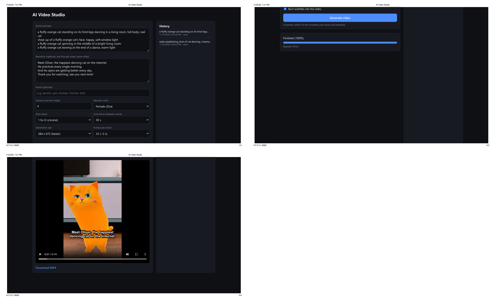
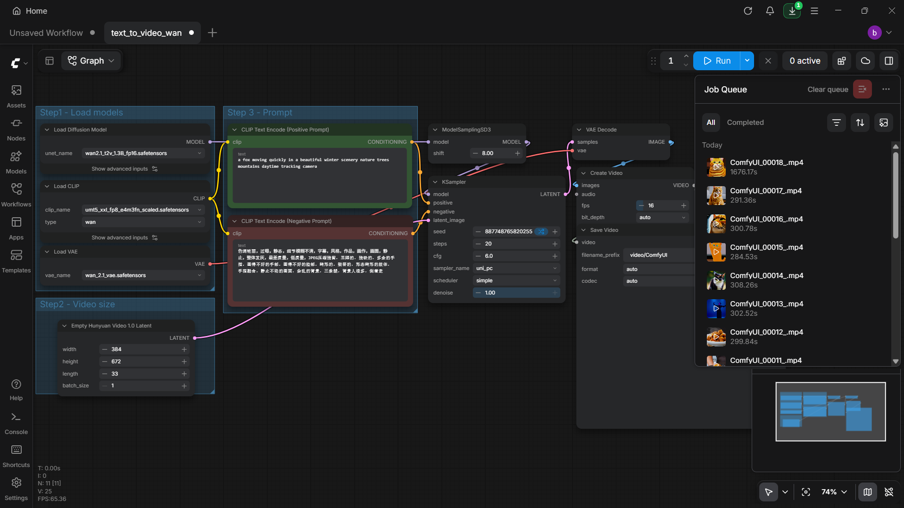

# ShortForge

**Local AI text-to-video generator for YouTube Shorts.** Runs fully offline on a laptop GPU with only **4 GB VRAM** (tested on an RTX 3050). Type a prompt and ShortForge creates several short AI clips with [ComfyUI](https://github.com/comfyanonymous/ComfyUI) and Wan 2.1, adds narration and subtitles, and exports a vertical 720 × 1280 MP4.


## Features

- Web interface with prompt box, progress bar, video preview, MP4 download and history
- Scene-based generation: one line becomes a subject with camera shots, or write one scene per line
- Local American English narration using built-in Windows voices (nothing to install)
- Subtitles burned into the video with FFmpeg
- Optional background music
- Output upscaled to 720 × 1280 (9:16)
- Cool-down setting between scenes to protect a laptop GPU from overheating
- No paid APIs and no cloud: everything runs on your own machine

## Screenshots

| App | ComfyUI workflow |
|---|---|
|  |  |

Sample output: [docs/sample-short.mp4](docs/sample-short.mp4)

## How it works

```
Browser (frontend/index.html)
        |  HTTP
FastAPI backend (backend/app.py): job queue and history
        |
        +-- comfy_client.py --> ComfyUI API --> Wan 2.1 (1.3B) --> ~2 s clips
        +-- make_video.py   --> FFmpeg: slow-down, upscale, narration, subtitles, music --> final MP4
```

A 4 GB GPU can only generate short clips, so each scene is about 2 seconds (33 frames at 16 fps, 384 × 672). Scenes are slowed down 1.5x, upscaled to 720 × 1280 and joined. A 60-second Short takes roughly 20 scenes.

## Requirements

- Windows 11
- NVIDIA GPU with 4 GB VRAM or more (16 GB system RAM recommended)
- [ComfyUI Desktop](https://www.comfy.org/download)
- Python 3.10 or newer
- [FFmpeg](https://ffmpeg.org/): `winget install Gyan.FFmpeg`

## Setup

### 1. Download the Wan 2.1 models

Download these from the [Comfy-Org/Wan_2.1_ComfyUI_repackaged](https://huggingface.co/Comfy-Org/Wan_2.1_ComfyUI_repackaged/tree/main/split_files) page and place them in your ComfyUI `models` folder:

| File | Folder | Size |
|---|---|---|
| `wan2.1_t2v_1.3B_fp16.safetensors` | `models/diffusion_models` | ~2.8 GB |
| `umt5_xxl_fp8_e4m3fn_scaled.safetensors` | `models/text_encoders` | ~6.5 GB |
| `wan_2.1_vae.safetensors` | `models/vae` | ~0.25 GB |

### 2. Install the project

```
git clone https://github.com/YOUR_USERNAME/shortforge.git
cd shortforge
python -m venv .venv
.\.venv\Scripts\Activate.ps1
pip install -r requirements.txt
```

### 3. Workflow file

`workflows/wan_t2v_api.json` is the ComfyUI **Wan 2.1 Text to Video** template exported in API format. To use your own, open the template in ComfyUI, enable Dev mode in Settings, use **File → Export (API)**, and replace the file.

### 4. Run

1. Start ComfyUI Desktop and leave it running.
2. Start the app:
   ```
   python backend\app.py
   ```
3. Open http://127.0.0.1:8080

Finished videos are saved in `outputs/final/`.

## Usage tips

- **One subject and one action per scene.** A small model drops extra ideas. Describe animals explicitly (for example "a real fluffy orange cat") and use the **Avoid** box for things you don't want (for example "person, girl, woman").
- Several lines in the prompt box give one scene per line, which looks better than the automatic split.
- Narration lines match scenes in order. Keep each to 8 to 14 words.
- Background music: put an MP3 you have the rights to at `music/background.mp3`.
- If the laptop runs hot, use 320 × 576 and a 60-second cool-down.

## Measured performance (RTX 3050 Laptop, 4 GB)

| Size | Frames | Time per clip |
|---|---|---|
| 320 × 576 | 17 | ~74 s |
| 384 × 672 | 17 | ~69 s |
| 384 × 672 | 33 | ~158 s |
| 480 × 832 | 17 | ~159 s |

The first run after starting ComfyUI is slower because the models load from disk.

## Limitations

- Clips are about 2 seconds, so a full Short is many scenes joined together.
- Wan 2.1 1.3B is a small model: complex prompts (several subjects, speech, on-screen text) are not followed reliably, and characters are not identical between scenes.
- Narration uses Windows built-in voices (Zira and David), so it is Windows-only.
- Subtitles come from your narration text rather than speech recognition.

## Roadmap

- Image-to-video for consistent characters
- Local LLM (Ollama) for smarter scene splitting
- Better voices (Piper or Kokoro)
- Whisper-based subtitles

## Credits

- [ComfyUI](https://github.com/comfyanonymous/ComfyUI)
- [Wan 2.1](https://github.com/Wan-Video/Wan2.1) by Alibaba (Apache 2.0)
- [FFmpeg](https://ffmpeg.org/)
- [FastAPI](https://fastapi.tiangolo.com/)

## License

MIT, see [LICENSE](LICENSE). The Wan 2.1 models have their own license (Apache 2.0).
